# fistbump


A local-first job application assistant. Stores a master resume (`.pdf`, `.docx`, `.odt`, `.md`, `.txt` import), searches Greenhouse, Lever, and Ashby job boards, shows skill gaps and pay/cost-of-living analysis, generates reviewable resume revisions, exports PDF/DOCX, tracks applications, plans interviews on a calendar, and includes 23 style and seasonal themes, each in Day, Night and Darker. Resumes and application records are stored locally. Remote AI, community submissions, and external calendar connections are optional.

Fistbump uses Tauri v2, a Go backend, and SQLite.

## What’s coming in v0.6.0

The next release expands Greenhouse, Lever, and Ashby coverage, refreshes recently searched boards in the background, improves resume imports, and hardens credentials, exports, and community publishing. [Release notes](docs/release-notes.md)

## What it looks like

| | |
|---|---|
| 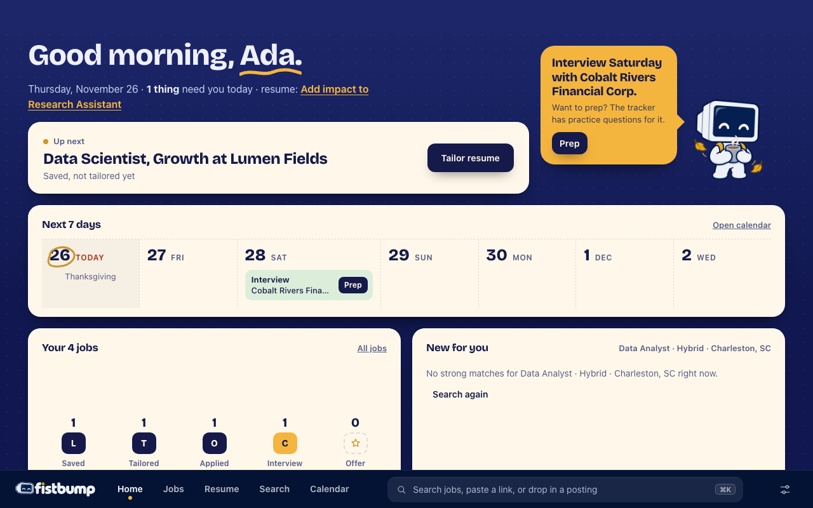 | 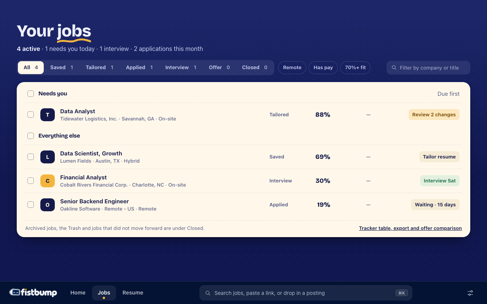 |
| **Home.** The one thing to do next, the next seven days, your jobs by stage, Pico's tip, and new matches. | **Your jobs.** Every job in one list, grouped by what needs you, filtered by stage, with bulk actions. |
| 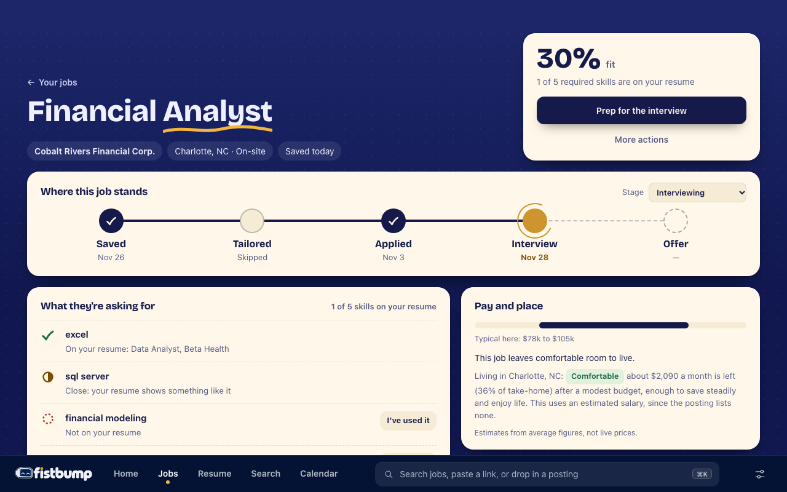 | 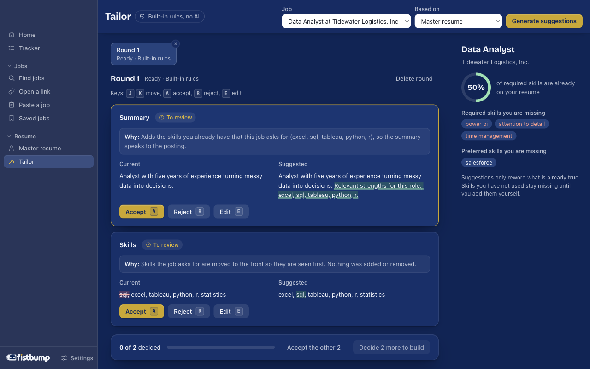 |
| **A job.** Where it stands, one next step, each required skill against your resume, pay and place, notes. | **Tailor.** Your resume as a page with every suggestion in place; accept, reject, or edit each one. |
| 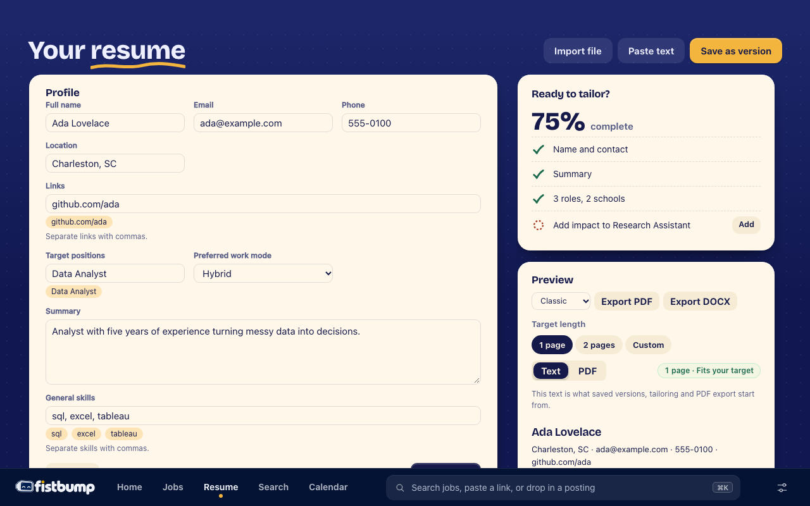 | 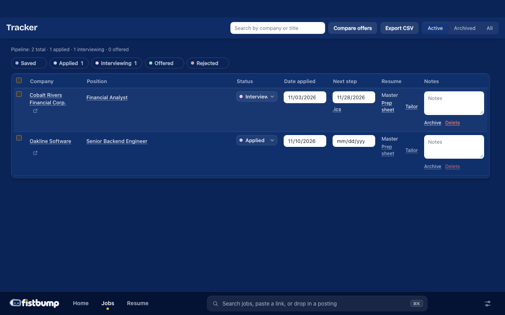 |
| **Your resume.** Your one source of truth, how ready it is, and a live PDF preview. | **Tracker.** Every application on one sheet: dates, stage and notes edit in place, and what needs you comes first. |
| 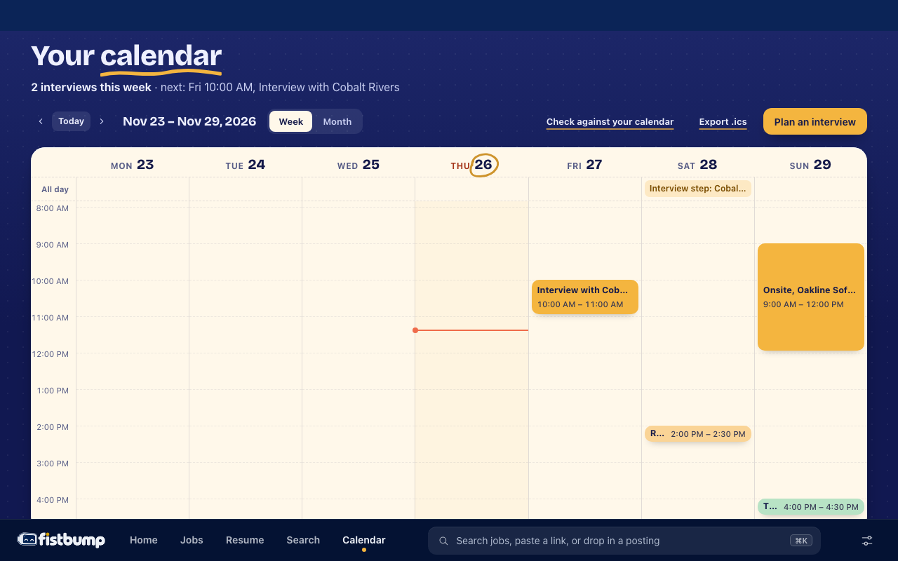 | 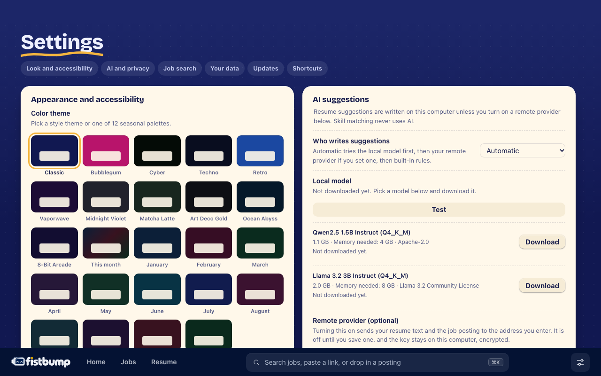 |
| **Calendar.** Interviews, calls and follow-ups by week or month, with clashes flagged; add any plan to Apple Calendar, Outlook or Google. | **Settings.** 23 themes in Day, Night or Darker, paper and accent, accessibility, AI engine, calendar, and storage. |

### Themes

Choose from 11 style themes (**Classic**, **Bubblegum**, **Cyber**, **Techno**, **Retro**, **Vaporwave**, **Midnight Violet**, **Matcha Latte**, **Art Deco Gold**, **Ocean Abyss**, **8-Bit Arcade**) and 12 monthly seasonal themes with custom offline SVG art (plus **Auto (Current Month)**). Every theme comes in **Night**, **Day** and **Darker** (dark paper, light ink), or follows your system. See the [v0.5.0 release](https://github.com/tlmcguire/fistbump/releases/tag/v0.5.0) for its theme gallery.

| | |
|---|---|
| 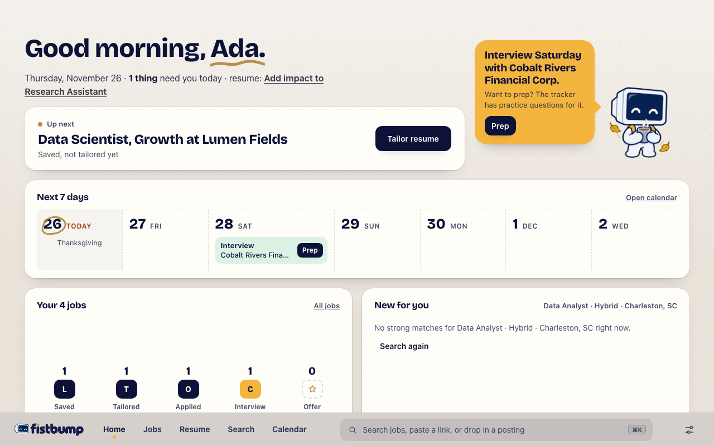 | 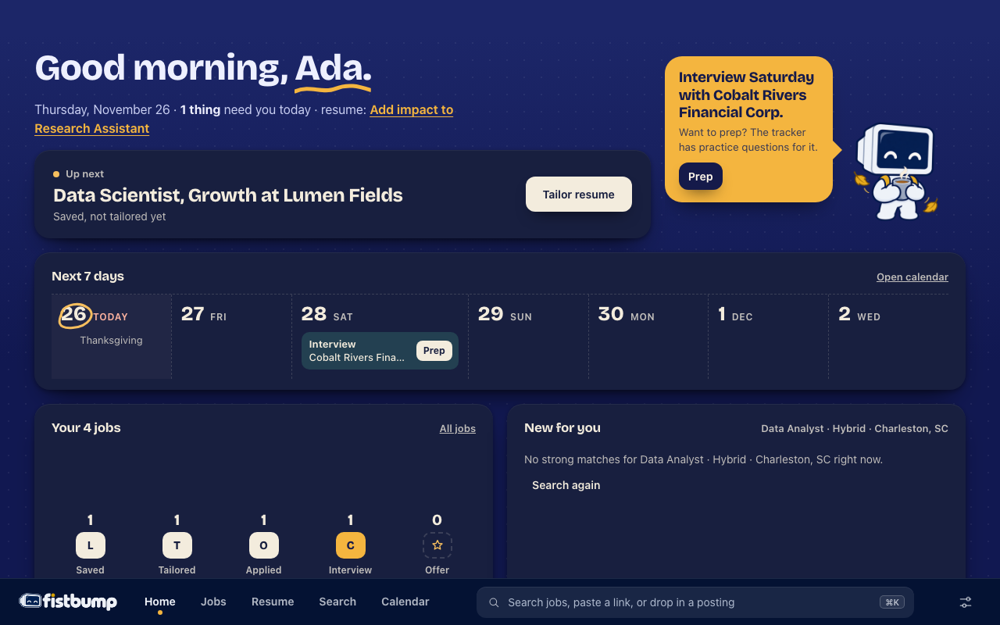 |
| **Day.** Each theme's light version, made from its own colors. | **Darker.** Dark paper with light ink, for dark rooms. |
| 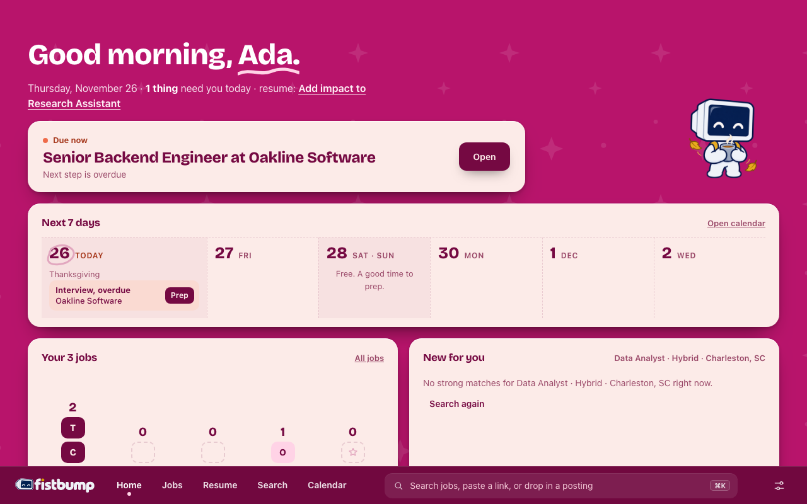 | 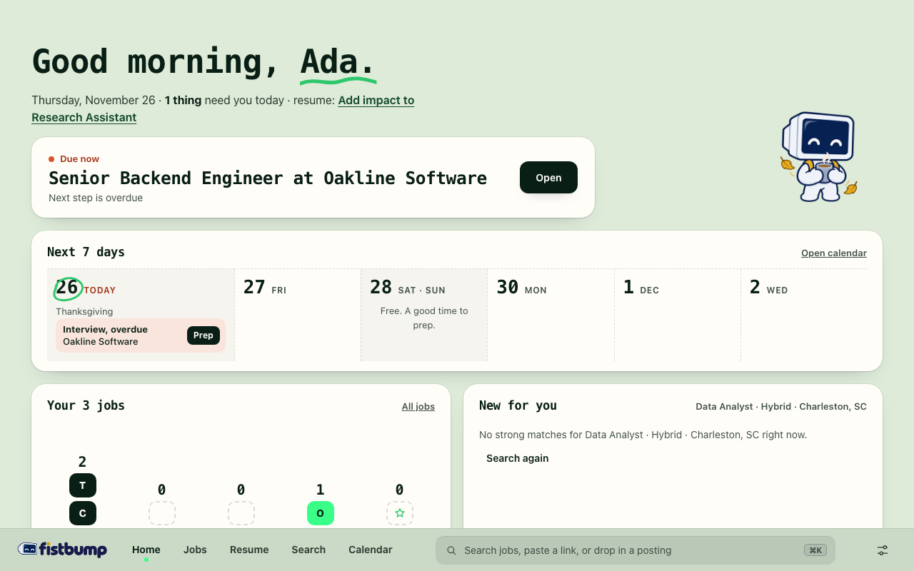 |
| 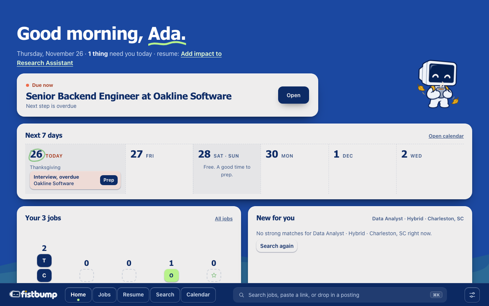 | 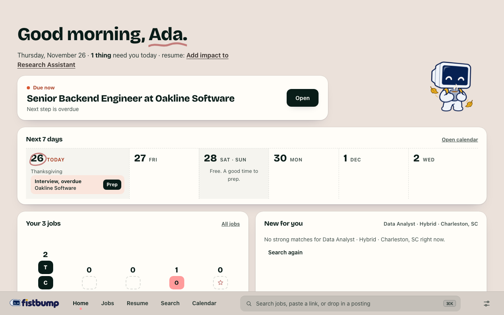 |

## Install

The installers are on the releases page: [github.com/tlmcguire/fistbump/releases](https://github.com/tlmcguire/fistbump/releases).

| Platform | Installer | Architectures |
|----------|-----------|---------------|
| Windows 10 and 11 | NSIS `.exe` | x64 |
| macOS 12 and later | `.dmg` | arm64 and x64, as two files |
| Linux (Ubuntu 22.04 and later, Fedora 36 and later) | `.AppImage` | x64 |

The builds are unsigned, so the first launch asks you to open the app yourself. The [user guide](docs/user-guide.md) has the steps for each platform.

## Documentation

| Doc | Contents |
|-----|----------|
| [docs/user-guide.md](docs/user-guide.md) | How to install, set up the resume, tailor it to a job, customize themes, and track applications |
| [docs/release-notes.md](docs/release-notes.md) | Highlights and upgrade instructions for the next release |
| [docs/release-checklist.md](docs/release-checklist.md) | The manual check to run on every platform before publishing a release |
| [docs/architecture.md](docs/architecture.md) | System design, app lifecycle, ATS board search strategy, API key handling, file structure, Q&A |
| [docs/security-policy.md](docs/security-policy.md) | Desktop trust boundaries, credentials, community validation, and automation |
| [docs/periodic-external-calls.md](docs/periodic-external-calls.md) | Scheduled network calls and ATS dataset credits |
| [docs/api.md](docs/api.md) | Backend routes, request and response shapes, error format, DB interactions |
| [docs/schema.md](docs/schema.md) | SQLite tables, relationships, constraints, settings keys |
| [CONTRIBUTING.md](CONTRIBUTING.md) | Contribution guide |

## Developer setup

You need Rust (stable), Go 1.26, and Node 22. On Linux, also install Tauri's system packages (`libwebkit2gtk-4.1-dev`, `libappindicator3-dev`, `librsvg2-dev`, `patchelf`, `libsecret-1-dev`).

```bash
npm install          # install dependencies and sync PDF.js assets
npm run build:go     # build the Go backend into bin/<platform>-<arch>/
npm run dev          # start the Tauri app
```

The pictures above come from `node scripts/screenshots.js` (main views into `docs/images/`) and `node scripts/theme-screenshots.js` (all 22 new themes into `docs/images/themes/`, and their Day versions into `docs/images/themes/day/`).

`npm run build:go` builds the backend for this computer. To build for another platform or architecture, name it: `node scripts/build-go.js --platform darwin --arch x64`.

## Repository layout

| Path | Contents |
|------|----------|
| `src-tauri/` | Tauri v2 Rust host: Go backend supervisor, IPC commands, OS keychain, menus, updater, icons |
| `app/` | Vanilla JS/HTML/CSS renderer views, Tauri bridge, PDF.js preview, and renderer tests |
| `backend/` | Go module (`fistbump-core`): API, SQLite store, parser, analysis, AI providers, Greenhouse/Lever/Ashby connectors |
| `relay/` | Cloudflare Worker community relay for shared boards, shared listings, and in-app bug reports |
| `data/` | Community-shared job boards (`community-boards.json`) and external listings (`community-listings.json`) |
| `e2e/` | Playwright Chromium smoke tests backed by the real `fistbump-core` binary |
| `scripts/` | Build, resource staging, PDF.js sync, board/cost updaters, listing pruner, and security audit scripts |
| `docs/` | Architecture, API, schema, user guide, security policy, and periodic external calls documentation |

The full tree is in [docs/architecture.md](docs/architecture.md#file-structure).

## Commands

| Command | Purpose |
|---------|---------|
| `npm run dev` | Start the Tauri desktop app in dev mode |
| `npm run build:go` | Build the Go backend into `bin/<platform>-<arch>/` |
| `npm run fetch:llama` | Put a pinned `llama-server` next to the backend so the local AI engine can run (`--all` for every platform) |
| `npm run stage:resources` | Stage `bin/<platform>-<arch>/` into `src-tauri/resources/bin/` for Tauri bundling |
| `npm run dist` | Build installers for the current platform (and signed updater artifacts when `TAURI_SIGNING_PRIVATE_KEY` is set) |
| `npm run dist:mac`, `npm run dist:win`, `npm run dist:linux` | Build installers for one platform |
| `cd backend && go test ./...` | Run Go backend tests |
| `npm run test:rust` | Run Rust host tests (`cargo test` in `src-tauri/`) |
| `npm test` | Run renderer, script, and security audit tests |
| `node --test relay/test/relay.test.js` | Run Cloudflare Worker relay unit tests |
| `npm run test:e2e` | Run Playwright Chromium end-to-end tests against `fistbump-core` |
| `node scripts/verify-greenhouse-boards.js` | Validate the Greenhouse board lists against the live API (`--offline` checks structure only) |
| `node scripts/verify-community-data.js` | Run security, typosquat, URL, and timeframe checks on community and public board catalogs |
| `node scripts/update-ats-boards.js` | Refresh `public_boards.json` from allowlisted Hugging Face and Common Crawl sources (`--offline` validates only) |
| `node scripts/prune-community-listings.js` | Prune expired, closed, or dateless listings from `data/community-listings.json` (`--offline --dry-run` for local check) |
