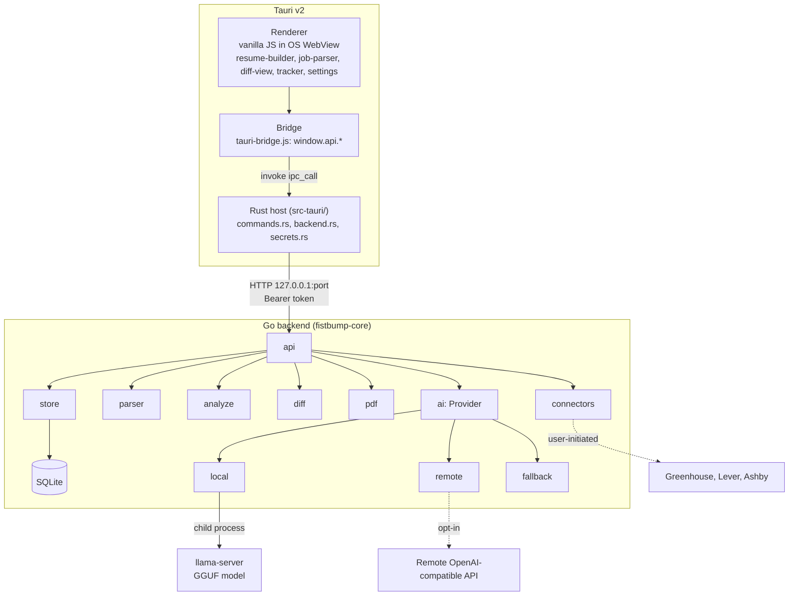
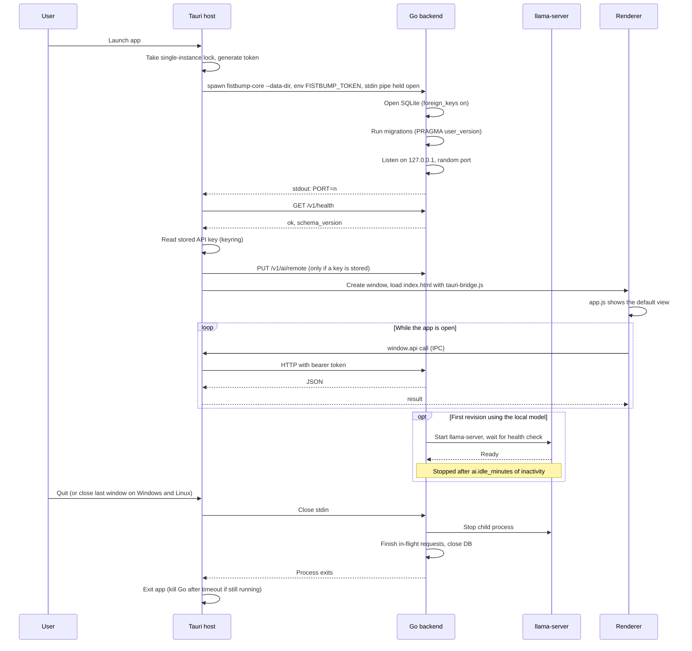
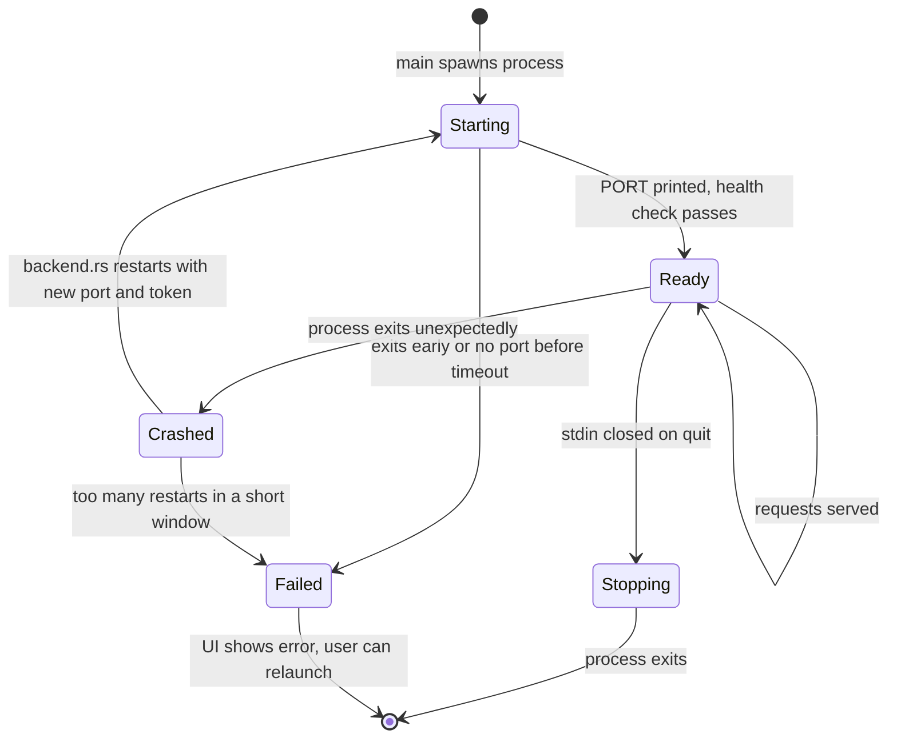
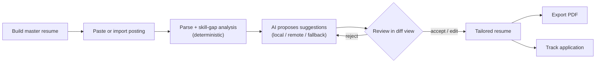
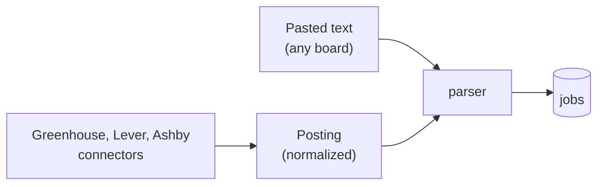
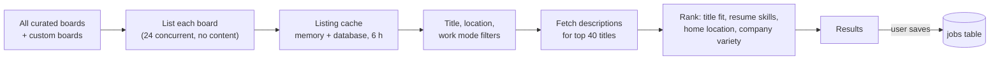
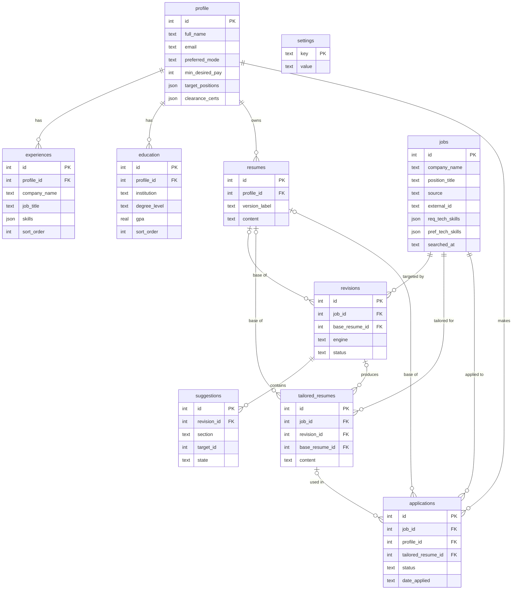
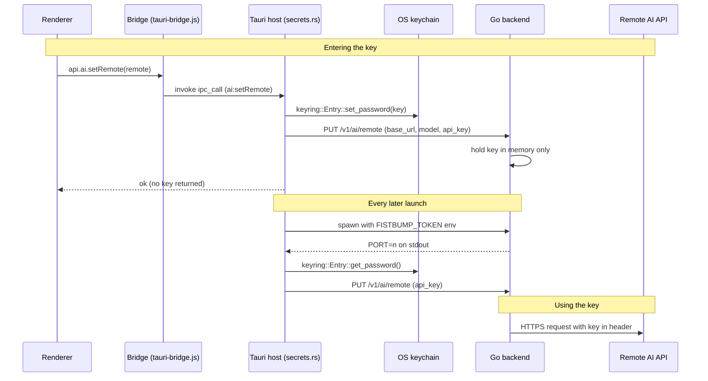

# FistBump Architecture

FistBump is a local-first desktop app. It stores a master resume, parses job postings, shows skill gaps, and generates resume revisions that the user reviews before exporting a PDF. Data stays on the user's machine unless a remote AI provider is configured.

## Goals and constraints

| ID | Constraint | Design consequence |
|----|------------|--------------------|
| NFR-1 | Data and inference stay local (or on user-supplied compute) | SQLite on disk; local `llama-server`; remote AI is opt-in with the user's own key |
| NFR-2 | Windows, macOS, Linux | Tauri v2 Rust shell; pure-Go backend (no cgo) cross-compiled per OS/arch |
| NFR-3 | Skill-gap analysis under 1.5 s | Analysis is deterministic and never calls a model |
| NFR-4 | User controls final text | Every AI change is a suggestion with accept/reject/edit |
| NFR-5 | Install under 250 MB, excluding model weights | Models are downloaded on demand; cache cleanup and job GC |

## System overview



## App lifecycle

### Startup to shutdown



### Backend process states



### Notes

- **Startup order.** The window opens after the backend is healthy and the stored key is delivered. A startup failure shows an error screen with the stderr tail.
- **Single instance.** A lock prevents two apps from opening the same database.
- **Local model.** `llama-server` starts on the first local revision or test call and stops after `ai.idle_minutes` (default 5).
- **Background work.** Revision generation and model downloads run in the backend. The UI polls status routes.
- **Crash recovery.** `backend.rs` restarts the backend with a new port and token and re-sends the API key. In-flight requests fail and the UI offers a retry. Repeated crashes stop the restarts and show an error.
- **Shutdown.** Closing stdin is the quit signal on every platform. It also covers the Tauri host dying, since Go exits on stdin close. On macOS, closing the last window does not quit the app.
- **Timeouts.** 10 s startup, 5 s shutdown.

## Tauri desktop app (`src-tauri/` & `app/renderer/`)

- **Renderer (`app/renderer/`)** runs in the OS WebView with no filesystem or process access. `js/app.js` is a view router; `js/api.js` wraps `window.api`.
- **Bridge (`js/tauri-bridge.js`)** exposes the named `window.api` surface over Tauri's `invoke`/`listen` APIs. The renderer never sees the backend port or bearer token.
- **Rust host (`src-tauri/src/`)**
  - `backend.rs` spawns the Go binary, reads the port from its stdout, attaches the bearer token to every request, and restarts it on crash.
  - `commands.rs` and `routes.rs` validate IPC channels and forward them to `fistbump-core`, and own the native open/save dialogs for import and PDF export.
  - `secrets.rs` stores the remote API key in the OS keychain via `keyring` and re-sends it to Go at launch, so the key is never written to the database.
  - `lib.rs`, `menus.rs`, and `updates.rs` handle window chrome, vibrancy, menus, single-instance locking, and signed auto-updates.

## Go backend (`backend/`)

A single module, `cmd/fistbump-core`, with everything under `internal/`. Every `foo.go` has an adjacent `foo_test.go` in the same package.

| Package | Responsibility |
|---------|----------------|
| `api` | HTTP server, routes under `/v1`, bearer-token middleware, panic recovery, JSON helpers |
| `db` | Opens SQLite (`modernc.org/sqlite`, pure Go) with foreign keys on; embedded migrations tracked via `PRAGMA user_version` |
| `store` | SQL CRUD, one file per table; settings key-value store; job GC by `searched_at` |
| `models` | Types shared across packages only |
| `parser` | Posting text cleanup, keyword and n-gram extraction |
| `analyze` | Deterministic skill-gap comparison of posting vs. master resume |
| `diff` | Bullet-level diff generation for the diff view |
| `ai` | Provider abstraction, model catalog and downloads (below) |
| `connectors` | Job search and imports behind one `FetchPostings(query)` interface; Greenhouse first |
| `pdf` | PDF export (gofpdf/maroto) |

### Process contract

- Flag `--data-dir` sets where the database and models live.
- Logs go to **stderr**. **stdout carries only the port line**, which the Tauri host parses.
- Listens on `127.0.0.1` only, on a random port.
- Exits when stdin closes.
- Requests without the correct bearer token are rejected.

### AI layer

`Provider` is the interface the API layer calls. Implementations:

1. **local**: manages a `llama-server` child process (start, health check, idle stop) for on-device GGUF models.
2. **remote**: OpenAI-compatible client, covering hosted APIs and Ollama. Enabled when a key or endpoint is configured.
3. **fallback**: rule-based templates. Always available.

If the configured provider is missing, unreachable, or out of resources, the request falls through to the next option. Skill-gap analysis never uses a provider.

Models come from an embedded `catalog.json` (repo, file, revision, sha256, size, min RAM). `download.go` fetches from Hugging Face with resume, SHA-256 verification, and an atomic rename; `models.go` checks what is installed on disk.

## Core workflow



Routes: `/v1/resume`, `/v1/jobs`, `/v1/revisions`, `/v1/tailored-resumes`, `/v1/applications`.

## Job board support

Pasting text works for every board. Connectors are built in for Greenhouse, Lever, and Ashby.



- **Interface:** each connector implements `FetchPostings(query) ([]Posting, error)` and returns a normalized `Posting`. Downstream code treats imported and pasted postings the same.
- **Supported ATS connectors:** Greenhouse (`boards-api.greenhouse.io`), Lever (`api.lever.co`), and Ashby (`api.ashbyhq.com`) all use public unauthenticated APIs.
- **Re-import:** a known posting (matched by `source` and `external_id`) gets a new `searched_at`. Postings not seen again are removed by GC.
- **Network policy:** job search runs only when the user presses Search, opens a listing, or saves a posting. Background reference updaters (`cost.StartUpdater` and `connectors.StartBoardUpdater`) check every 24 hours whether 30 days have elapsed since the last refresh; see [periodic-external-calls.md](periodic-external-calls.md).

### Searching Greenhouse

The Greenhouse job board API has no search. `GET /v1/boards/{board}/jobs` returns every open posting for one company board (title, location, id, no description), and `GET /v1/boards/{board}/jobs/{id}` returns one posting with its description. Search is implemented locally in two stages.



- **Board set.** By default every curated board plus the user's custom tokens (`connectors.greenhouse.boards`), de-duplicated. Listings without descriptions are small (517 boards, about 39,000 postings, 35 MB, roughly 3 s cold), so the user does not pick boards. A request can narrow the set with `categories` (an industry filter) or explicit `boards`.
- **Keywords.** Request keywords, else `profile.target_positions`, else the title of the most recent experience. Titles are matched by words, not phrases: seniority words are ignored, common synonyms are folded (developer and engineer, front end and frontend), and an exact phrase ranks higher.
- **Filters.** Location terms match the posting location; remote postings pass a location filter unless the user wants on-site. Remote must be stated in the posting; hybrid and on-site pass when the posting does not say.
- **Rank.** Descriptions are fetched for the 40 best title matches (5 s per request, 8 s for the stage) and scored by overlap with resume skills. Postings near `profile.home_location` rank higher, postings in other countries lower. No company fills more than 3 of the top slots. Ranking is deterministic and does not call AI.
- **Cache.** Listings are cached in memory and in the `greenhouse_listing_cache` table for 6 hours, descriptions in memory and in `greenhouse_description_cache` for 24 hours. At launch, rows older than a day are deleted. Storage cleanup of `cache` clears both tables. A board that returns 404 is remembered and reported in `errors`.
- **Persistence.** Search results are not written to the database. Saving a posting fetches its description if needed and stores it with `source = 'greenhouse'` and `external_id` set to the Greenhouse job id. Saving again refreshes `searched_at`.
- **Network.** Requests carry only public board tokens and job ids. Keywords, filters and the resume stay on the computer, because filtering and ranking are local. See the network policy above.

### Curated and public board lists

Bundled lists of company boards, grouped by industry, give users a starting point without hand-entering tokens, supplemented by a 30-day public dataset catalog and community-shared boards.

- **Curated sources.** `backend/internal/connectors/greenhouse/boards.json` (1,440 unique boards), `backend/internal/connectors/lever/boards.go` (405 unique boards), and `backend/internal/connectors/ashby/boards.go` (412 unique boards), all embedded in the Go binary.
- **Categories.** 58 categories total (40 top-level industries and 18 subsets of `technical`).
- **Subsets.** A category with a `parent` is a subset. Enabling a parent searches its own boards plus every subset's boards. Enabling a subset searches only that subset. Subsets are one level deep. A board listed in a subset is not repeated in the parent.
- **Current curated size.** 2,257 unique boards across Greenhouse, Lever, and Ashby in 58 categories.
- **30-day public dataset catalog.** `backend/internal/connectors/public_boards.json` (loaded and refreshed via `public_boards.go`) merges additional Greenhouse, Lever, and Ashby tokens pulled monthly from allowlisted public datasets (Hugging Face Datasets Server and Common Crawl CDX). See [periodic-external-calls.md](periodic-external-calls.md) and [security-policy.md](security-policy.md).
- **Community relay.** Users can opt in to share discovered boards and external listings via the Cloudflare Worker in `relay/`. Every submission is validated, scrubbed, and queued into a Pull Request for maintainer review.
- **Format.**

```json
{
  "version": 1,
  "verified_at": "2026-10-04",
  "categories": [
    {
      "id": "ai_ml",
      "name": "AI and machine learning",
      "parent": "technical",
      "boards": [{ "token": "example", "company": "Example Inc", "website": "https://example.com/" }]
    }
  ]
}
```

- **Website.** Optional. The company's home page, checked to load and to name the company in its title. Postings use it as `company_url`, the Company website button, reduced to the site's front page. Without it, the home page of the posting's own-site link is used when there is one (see [phase01.md](phase01.md)).
- **Membership.** A company may appear in more than one category. Tokens are de-duplicated when categories are combined.
- **Selection.** Categories are enabled in the connector settings view and stored as a JSON array in `connectors.greenhouse.categories` (default `[]`). `store/settings.go` returns the default when the key is absent, so no migration is needed.
- **Coverage.** The lists are not exhaustive and cannot be. The medical category skews toward health-tech, digital health, and diagnostics companies. Large hospital systems, insurers, and medical device manufacturers mostly use other applicant tracking systems and are largely absent. Only employers that publish on Greenhouse have a board, and many large employers use other applicant tracking systems. The settings view and search results state that lists are curated starting points. Responses report `boards_searched` so coverage is visible.
- **Discovery.** Greenhouse has no public directory of boards. Candidates were generated from company names (the Y Combinator directory, the S&P 500, a Wikipedia list of unicorn startups, and hand-picked names), each tried as a token against the API. A board is accepted only if it returns open postings and its returned company name matches the candidate. Most companies in those lists use other applicant tracking systems, so the hit rate is low. Collisions on short or generic tokens are rejected manually.
- **Maintenance.** Tokens are verified against the Greenhouse API before they are added. Boards can be renamed or removed upstream, so a board that returns 404 at runtime is skipped and reported in the response `errors`. `scripts/verify-greenhouse-boards.js --offline` validates structure (unique category ids, valid tokens, no duplicates within a category, parents exist and are top level). Without `--offline` it also requests every token from the live API and fails on any non-200 response or board with no open postings. Run it before editing the file and on a schedule.
- **Per-request cap.** The number of boards fetched in one request is capped. Large categories rely on the in-memory cache across searches.

### Limitations

- **Per-company only:** Greenhouse lists postings for one company board at a time. There is no cross-company search.
- **Aggregators are paste-only:** LinkedIn, Indeed, Handshake, and ClearanceJobs have no open posting API for this use, require login, and restrict scraping. FistBump does not scrape them or automate a logged-in session.
- **Pasted text is unstructured:** title, company, and URL are entered by the user or inferred. Parse quality depends on the text.
- **Supported ATS only:** employers on other systems fall back to paste.
- **Upstream changes:** a third-party API change breaks only that connector. Paste keeps working.
- **No submission:** FistBump tracks applications. It does not apply or autofill forms.

## Data model

SQLite, created from `backend/internal/db/migrations/001_init.sql`. The diagram shows keys and the main columns. [schema.md](schema.md) has every column, constraint, index, and delete rule.



`jobs.searched_at` is refreshed on re-import and drives garbage collection. Applications reference jobs with `ON DELETE RESTRICT`, so tracked jobs are never collected. Skills are stored as JSON arrays on `experiences` and `jobs`, not in a separate table. `settings` is a standalone key-value table with defaults applied in code.

## File structure

```
fistbump/
├── README.md
├── .gitignore
├── package.json
├── src-tauri/
│   ├── Cargo.toml
│   ├── tauri.conf.json
│   ├── capabilities/    default.json
│   ├── icons/           32x32, 128x128, 128x128@2x, 512x512 PNGs
│   ├── resources/bin/   staged fistbump-core + llama-server binaries (gitignored)
│   └── src/             main.rs, lib.rs, backend.rs, commands.rs, routes.rs, secrets.rs, menus.rs, updates.rs
├── app/
│   ├── renderer/
│   │   ├── index.html
│   │   ├── error.html
│   │   ├── styles/      base.css, views.css, finish.css, motion.css
│   │   ├── js/          tauri-bridge.js, app.js, api.js, pdf-preview.js, prefs.js, i18n.js
│   │   ├── vendor/      pdfjs/ (synced by postinstall, gitignored)
│   │   └── views/       home/, resume-builder/, job-parser/, diff-view/, tracker/, settings/
│   └── tests/
├── backend/
│   ├── go.mod
│   ├── cmd/fistbump-core/main.go
│   ├── internal/
│   │   ├── api/         server, middleware, respond, resume, jobs, revisions,
│   │   │                tailored, applications, connectors, ai, models, settings, storage
│   │   ├── db/          db.go, migrations/
│   │   ├── models/
│   │   ├── store/       profile, experience, education, resume, job_listing, revision,
│   │   │                suggestion, tailored_resume, application, settings, gc
│   │   ├── parser/
│   │   ├── analyze/
│   │   ├── diff/
│   │   ├── ai/          provider, local, remote, fallback, models, download, catalog.json
│   │   ├── connectors/  connector.go, public_boards.go, public_boards.json, greenhouse/, lever/, ashby/
│   │   ├── cost/        sources.json, updater.go
│   │   └── pdf/
│   └── testdata/        seed.sql, postings/, api/
├── relay/               Cloudflare Worker community relay (src/index.js, test/relay.test.js, wrangler.toml)
├── data/                community-boards.json, community-listings.json
├── e2e/                 harness.js, fixtures.js, smoke.spec.js
├── bin/                 Go build output + llama-server per OS/arch (gitignored)
├── build/               installer artwork (icon.icns/ico/png, background.tiff, installerSidebar.bmp)
├── scripts/             build-go.js, fetch-llama-server.js, stage-resources.js, sync-pdfjs.js, screenshots.js,
│                        update-ats-boards.js, update-cost-data.js, prune-community-listings.js, verify-community-data.js
├── docs/                architecture.md, schema.md, api.md, user-guide.md, release-checklist.md,
│                        security-policy.md, periodic-external-calls.md
└── .github/workflows/   app.yml, build.yml, e2e.yml, go.yml, update-ats-boards.yml,
                         update-cost-data.yml, prune-community-listings.yml, verify-community-pr.yml
```

Each Go source file `foo.go` has an adjacent `foo_test.go`.

## API keys and secrets

The app handles three kinds of secret. None of them is stored in SQLite, written to logs, or readable by the renderer.

| Secret | Who needs it | Where it lives |
|--------|--------------|----------------|
| Backend bearer token | Tauri host and Go | Generated at launch, memory only, never persisted |
| Remote AI API key (user supplied) | Go `remote.go` | Stored in OS keychain via `keyring`, plaintext only in Go memory |
| Hugging Face token (optional, gated models) | Go `download.go` | Same as the remote AI key |

Greenhouse's public board API needs no key. A future connector that does (USAJOBS, for example) would use the same path as the Hugging Face token.



Handling:

- **Entry.** The settings view passes the key through the bridge method `ai.setRemote`. No method returns it. The renderer sees only `has_key` from `GET /v1/ai/status`.
- **Storage.** `secrets.rs` stores the key in the OS keychain via `keyring` (`com.fistbump.desktop`: macOS Keychain, Windows Credential Manager, Linux Secret Service). If no keyring is available, the key is kept for the session only and never written in plaintext.
- **Hand-off.** The Tauri host reads the key from the OS keychain and sends it to `PUT /v1/ai/remote`. Go holds it in memory and never writes it to disk. `backend.rs` re-sends it after every restart.
- **Backend token.** The Tauri host generates 32 random bytes per launch and passes them in `FISTBUMP_TOKEN`, not a command-line flag, so the token is absent from process listings. Go compares in constant time.
- **Outbound.** Go sends the key only to the configured `base_url`. HTTPS is required unless the host is loopback (local Ollama). Cross-host redirects are not followed.
- **Logging.** Middleware redacts `Authorization` and skips bodies on `/v1/ai/remote` and `/v1/models/token`. Remote error messages are trimmed before reaching the UI.
- **Removal.** Clearing the key removes the entry from the OS keychain and calls `DELETE /v1/ai/remote`.
- **Limits.** Malware running as the same OS user can read process memory or query the keystore. The design protects against other apps, other users, backups, and the renderer, not a compromised account.

## Security model

- Renderer runs inside the OS WebView with no direct filesystem or process access; only the Tauri bridge surface (`window.api`) is reachable.
- The backend is bound to loopback and gated by a per-launch bearer token.
- Secrets are handled as described in "API keys and secrets" above: stored in the OS keychain via `keyring`, memory only in Go, never in SQLite or logs.
- User-initiated actions drive remote AI, model downloads, and job search. Background 30-day dataset refreshes (`cost.StartUpdater`, `connectors.StartBoardUpdater`) enforce HTTPS-only, same-host redirects, and size caps; see [periodic-external-calls.md](periodic-external-calls.md).
- Community boards, community listings, and public ATS datasets pass multi-layer validation (relay edge checks, fetcher host allowlists, PR CI security gate, and weekly expiration pruning); see [security-policy.md](security-policy.md).

## Build and packaging

- `scripts/build-go.js` cross-compiles the backend into `bin/<os>-<arch>/`. No cgo is needed, so this works from any host.
- `scripts/fetch-llama-server.js` downloads the `llama-server` binary per OS for packaging.
- `scripts/stage-resources.js` stages `bin/<os>-<arch>/` into `src-tauri/resources/bin/` for `tauri.conf.json` (`bundle.resources`).
- `.github/workflows/build.yml` runs Go tests, JS tests, Rust tests, and a Tauri build matrix on Windows, macOS, and Linux.

## Testing

- Go: unit tests beside each source file (`cd backend && go test ./...`); fixtures in `backend/testdata` (`seed.sql`, sample postings, saved connector responses).
- Rust: host supervisor and IPC route validation tests in `src-tauri/src/` (`npm run test:rust`).
- JS: renderer wiring, i18n, and helper tests in `app/tests/` (`npm test`).
- E2E: Playwright Chromium smoke tests backed by `fistbump-core` in `e2e/` (`npm run test:e2e`).
- Latency check for NFR-3 on skill-gap analysis, plus fallback testing with no model present.

## Q&A

Settled questions. Add entries as questions are answered and remove items from "Open" when resolved.

**Why are most directories empty except for `.gitkeep`?**
The repo is scaffolded from the planned file tree. Top-level config files are real. Delete a `.gitkeep` when its directory gets real files.

**What is the source of truth for the schema?**
The migration files in `backend/internal/db/migrations/`, applied in order. [schema.md](schema.md) documents them and must change with them.

**Does skill-gap analysis use AI?**
No. `analyze` is deterministic (n-gram and keyword matching) to meet the NFR-3 limit of 1.5 s on any hardware. AI is used only for revisions.

**How is a resume imported?**
`POST /v1/resume/import` extracts text from a PDF (`resumeparse`, pure Go) or takes pasted text, and returns a draft for review. Extraction removes common word-processor artifacts: overprinted invisible glyphs, a decorative letter some heading fonts append to every run, icon glyphs, and superscripts split onto their own line. Skills a resume lists that no role mentions are stored on the profile, not credited to a job. A rules parser runs first. With a model available, the user can ask the model to read it instead; every value the model returns must appear in the resume text or it is dropped. Nothing is saved until `POST /v1/resume/import/apply`.

**Can model suggestions add claims?**
They should not. Proposals whose content words mostly do not appear in the resume or the job's skills are dropped, and the rules engine fills items the model skipped. A round where the model contributed nothing is labeled `rules`.

**What happens with no model installed, or when the remote API is down?**
The `rules` engine (`fallback.go`) produces template-based suggestions. `revisions.engine` records which engine ran.

**What leaves the machine?**
Three paths, each started by the user: the configured remote AI provider (opt-in; it receives the resume and posting text in the revision prompt), model downloads from Hugging Face, and job search (public board requests only, sent when the user presses Search, opens a listing, or saves a posting).

**How is the remote API key protected?**
`keyring` stores it in the OS keychain. Go holds it in memory only. The renderer can set it but not read it. See "API keys and secrets".

**Which job boards are supported?**
Paste works for any board. Greenhouse is the planned connector. LinkedIn, Indeed, Handshake, and ClearanceJobs are paste-only. See "Job board support".

**What may the Go process write to stdout?**
One line, `PORT=<n>`. Logs go to stderr. See [api.md](api.md).

**Why a pure-Go SQLite driver?**
`modernc.org/sqlite` needs no cgo, so the backend cross-compiles for all three platforms without a C toolchain.

**Can GC delete a job that has an application?**
No. `applications.job_id` is `ON DELETE RESTRICT`, and GC skips jobs with applications.

**How are Greenhouse listings searched?**
Greenhouse has no search endpoint. The backend lists every curated board, filters titles locally, and ranks the best matches against the resume. See "Searching Greenhouse".

**Why are CrowdStrike and Palo Alto Networks missing from the cybersecurity list?**
Neither has a Greenhouse board. Their tokens return 404 under every variant tried, so they publish on a different applicant tracking system. Users add postings from those employers by pasting the text. The same applies to most large employers in every category.

**Are the curated Greenhouse lists complete?**
No. They cover only employers that use Greenhouse and only the companies added to `boards.json`. Users can add custom board tokens.

**Doc style?**
No em dashes. Plain wording.

### Open

- **Persistent Greenhouse index.** Listings are cached as JSON in SQLite tables. If search across more boards gets slow, an FTS5 table is the extension point.

## Related docs

- [security-policy.md](security-policy.md): validation, domain-takeover controls, and listing expiration rules
- [periodic-external-calls.md](periodic-external-calls.md): inventory of all scheduled external network calls
- [api.md](api.md): every route, request/response shape, error shape, and the stdout rule
- [schema.md](schema.md): tables and relationships
- [roadmap.md](roadmap.md): phases to the MVP, with one plan per phase (`phase01.md` to `phase09.md`)
