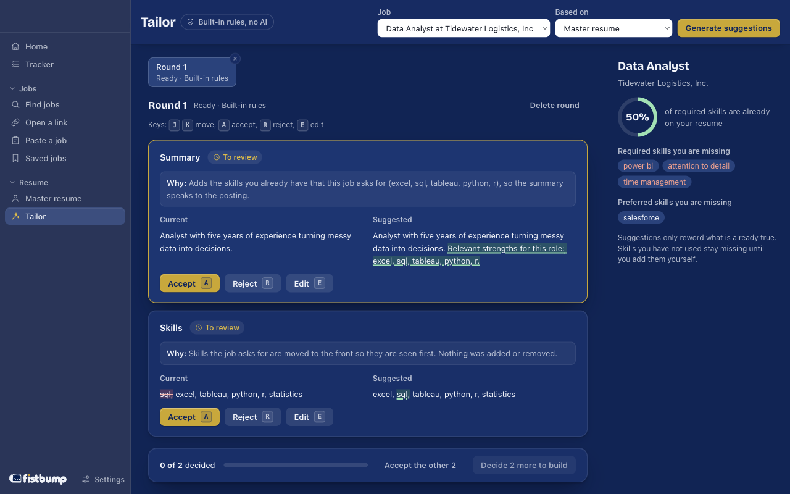

# Fistbump v0.1.0

The first release. Fistbump is a local-first job application assistant: your resume, the postings,
the skills they ask for that you do not have yet, a tailored resume you can export as a PDF, and a
tracker for the applications you sent. Your data stays on your computer unless you choose a remote
AI provider.

## What you can do

- **Keep one master resume.** Enter it by hand or import a file, see it as a live PDF, and save
  named versions.
- **Collect jobs.** Search Greenhouse boards, open a link, or paste a posting. Postings are parsed
  into company, title, location, pay and the skills they ask for.
- **See the skill gap.** Required and preferred skills your resume does not show yet, with a match
  score. Matching is lenient: a skill under another name counts, and soft skills you do not name
  are marked "Not mentioned" rather than missing. The search can run without your resume.
- **Tailor with review.** Rounds of suggestions, written by built-in rules, a local model or a
  remote provider. Nothing changes until you accept, reject or edit each one. A failed round says
  what went wrong and what to try. Rounds can be deleted with the x on their chip.
- **Export.** Build the tailored resume and save a PDF or Markdown.
- **Track applications.** Stages from Saved to Offered, dates, next steps and notes, with follow-ups
  on the Home view.
- **Stay in control of storage.** Settings shows what the app stores, previews a cleanup before
  anything is removed, and old untracked jobs and the Trash are cleared on their own.
- **Recover from a crash.** If the backend stops, the app restarts it. If it cannot start, an error
  screen shows what happened with a Copy details button.
- Four languages: English, Spanish, French and German.

## Installers

| Platform | File | Notes |
|----------|------|-------|
| Windows 10 and 11 | `FistBump-0.1.0 Setup.exe` | NSIS, x64, unsigned |
| macOS 12 and later, Apple silicon | `FistBump-0.1.0-arm64.dmg` | unsigned |
| macOS 12 and later, Intel | `FistBump-0.1.0.dmg` | unsigned |
| Ubuntu 20.04 and later, Fedora 36 and later | `FistBump-0.1.0.AppImage` | x64, unsigned |

The builds are not signed or notarized, so the first launch is stopped by the system: on macOS
right-click the app and choose Open, on Windows choose "More info" and then "Run anyway". The
user guide ([user-guide.md](user-guide.md)) walks through it.

## Install size against NFR-5

NFR-5 asks for an install under 250 MB, without model weights. Measured on macOS from a real
`npm run dist` build on November 22, 2026:

| | arm64 | x64 |
|---|---|---|
| Installer (`.dmg`) | 166.8 MB | 159.3 MB |
| Installed app bundle | 397.6 MB | 360.2 MB |
| Electron runtime | 288.3 MB | 297.6 MB |
| The app itself (`app.asar`) | 15.6 MB | 15.6 MB |
| `fistbump-core` (the Go backend) | 14.1 MB | 13.4 MB |
| `llama-server` and its libraries | 77.0 MB | 31.6 MB |

**The limit is not met.** The installed app is 397.6 MB on Apple silicon, 148 MB over the limit,
and the Electron runtime alone is 288.3 MB of it. No feature was dropped to close the gap, per the
phase 9 plan.

What the gap could be closed with, in order of how much it saves:

1. **Download `llama-server` on first use instead of bundling it.** Saves 77 MB on Apple silicon
   and 31.6 MB on Intel. The app would need a download step on first use of the local model, the
   same way a model is already downloaded. This is the option the plan names, and it is the only
   one that changes nothing about what the app can do.
2. **A leaner shell.** The Electron runtime is the largest single item. Moving to a native shell
   would replace it, but that is a rewrite of the app layer, not a release task.

Note that the installed size is what the user gets: the installer is smaller because the disk
image is compressed.

## Upgrading and data

This is the first release, so there is nothing to upgrade from. Your data lives in one folder (the
user guide shows where on each platform); copy it while the app is closed to back it up.

## Known limits

- Greenhouse only: the job board support covers companies that post on a Greenhouse board.
- Skill matching is strongest for technical roles. It compares the posting's skills with the
  resume's, so roles with a lot of soft skills get less help. It is deliberately lenient: a skill
  you have under another name counts (REST covers API), and a soft skill your resume does not name
  is listed as "Not mentioned" rather than missing. The search can also be run without the resume
  at all, by unticking **Match with my resume** in the filters.
- The builds are unsigned, so the first launch needs the extra click described above.
- The local model needs about 4 GB of free memory for the default one, and the model file itself
  is about 1 GB on disk, outside the install size above.

Full documentation: the [user guide](https://github.com/tlmcguire/fistbump/blob/main/docs/user-guide.md).
