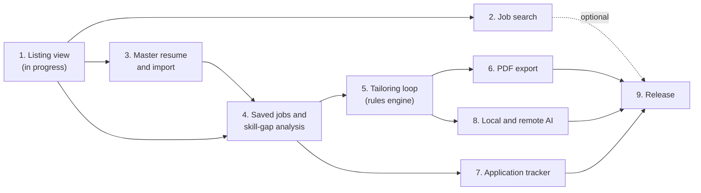

# Roadmap to the MVP

An overview of phases 1 to 9, from the [phase 1](phase01.md) listing view to release binaries. Each phase ends with something the app can show. This file covers order, scope, and dependencies; each `phaseNN.md` has the detail.

Plans: [architecture.md](architecture.md), [api.md](api.md), [schema.md](schema.md). `experiment/full-build` is a reference only, as in phase 1. [build-findings.md](build-findings.md) records what it learned.

## What the MVP is

The MVP meets the functional and non-functional requirements in the [proposal](proposal.pdf) and ships as Deliverable 3 (D3, November 10): release binaries (`.exe`, `.dmg`, `.AppImage`) and user documentation. D4 (November 24) is the demo and presentation.

| Requirement | Met by |
|-------------|--------|
| FR-1 Store, edit, and maintain a master resume locally | Phase 3 |
| FR-2 Parse posting text and highlight skill gaps against the master resume | Phase 4 |
| FR-3 AI-assisted revisions the user can accept, reject, or edit | Phase 5 (review loop, rules engine), phase 8 (local and remote models) |
| FR-4 Compile accepted revisions into a PDF on the local file system | Phase 6 |
| FR-5 Store jobs, application statuses, and resume versions locally | Phases 3, 4, 7 |
| FR-6 Linux, Windows, and macOS | Phase 9 |
| NFR-1 Data and inference stay local or on user-supplied compute | Phase 8 (keys, local model), every phase (no network calls without a user action) |
| NFR-2 Builds and runs on all three platforms | Phase 9 (CI build matrix) |
| NFR-3 Skill-gap analysis under 1.5 s | Phase 4 (latency test) |
| NFR-4 Side-by-side diff before export | Phase 5 |
| NFR-5 Install under 250 MB without model weights; storage controls | Phase 9 |

Job search (phase 2) is not in the proposal's requirements. It is planned because phase 1 already builds on Greenhouse, and it is the first phase to cut if the schedule slips (see "If the schedule slips"). Pasting a posting meets FR-2 on its own.

Out of scope for the MVP: everything in [build-findings.md](build-findings.md) section 8 (the team marked it post-MVP), plus the routes marked "after MVP" below.

## Order and dependencies

Phase 5 is built first with the rules engine, so the whole loop (resume, job, suggestions, review, export) works before any model runs. This follows the proposal's backup plan: without a model, the app falls back to deterministic rules. Phase 8 adds models behind the same interface.

After phase 4, three tracks can run in parallel: the tailoring loop and export (5, 6), the tracker (7), and AI (8, once phase 5 defines the `Provider` interface).

## Schedule

Proposed dates, written October 10, 2026. D3 is November 10.

| Phase | Start | Done by | Depends on |
|-------|-------|---------|------------|
| 1. Listing view | Oct 10 | Oct 14 | |
| 2. Job search | Oct 14 | Oct 20 | 1 |
| 3. Master resume and import | Oct 13 | Oct 22 (import may land after the core) | 1 |
| 4. Saved jobs and skill-gap analysis | Oct 19 | Oct 25 | 1, 3 |
| 5. Tailoring loop | Oct 23 | Oct 30 | 4 |
| 6. PDF export | Oct 29 | Nov 2 | 5 |
| 7. Application tracker | Oct 26 | Nov 1 | 4 |
| 8. Local and remote AI | Oct 26 | Nov 5 | 5 (`Provider` interface) |
| 9. Release | Nov 2 | Nov 9 | 6, 7, 8 |

CI (from phase 9) should start as soon as phase 1 merges: a workflow that runs `go test` and `npm test` on all three platforms catches cross-platform breaks while they are small. Feature freeze is November 7; November 7 to 9 is for packaging and bugs only. November 10 to 24 is buffer for demo fixes.

## Route coverage

Every group in [api.md](api.md), and the phase that builds it. Phase 1 registers all of them as `501 not_implemented`; each phase replaces its stubs.

| Group | Routes | Phase |
|-------|--------|-------|
| Health | `GET /v1/health` | 1 |
| Resume | All 10 | 3 |
| Resume import and generation | `GET /v1/resume/preview` | 3 |
| | `POST /v1/resume/export` | 6 |
| | `POST /v1/resume/import`, `/import/apply` (rules only) | 3 |
| | `POST /v1/resume/summary`, and AI reading of imports | After MVP |
| Saved resumes | All 5 | 3 |
| Jobs | `parse`, create, list, get, update, delete, `analyze` | 4 |
| | `archive`, `unarchive` | 7 |
| | `trash`, `restore` | 7, first to cut |
| Revisions | All 8 | 5 |
| Tailored resumes | Create, list, get, `diff`, delete | 5 |
| | `export` | 6 |
| Applications | All 9 | 7 |
| Connectors | Phase 1's two Greenhouse routes | 1 |
| | `GET /v1/connectors`, `fetch` | 2 |
| | `import` (changed to take board and job id pairs; see phase 4) | 4 |
| | `GET /v1/connectors/greenhouse/postings/{external_id}` | Replaced by phase 1's listing route; remove from api.md in phase 2 |
| | Categories (`GET`, `PUT`) and custom boards (`POST`, `DELETE`) | After MVP |
| AI | All 5 | 8 |
| Models | All except the Hugging Face token routes (6) | 8 |
| | `PUT`, `DELETE /v1/models/token` | After MVP |
| Settings | Both | 3 |
| Storage | Both | 9 |

Routes left for after the MVP keep returning `501`, so the contract does not change when they arrive.

## Schema changes

Two are needed for the MVP, both on `jobs` in phase 4:

- **`jobs.board`**: the Greenhouse board token, so a saved job can be fetched again (see phase 1, "For later"). NULL for pasted and manual jobs.
- **`jobs.company_url`**: a direct link to the company (its own job page, or its site), so a saved job is not reachable only through Greenhouse (see phase 1, `company_url`).

One more is recommended while it is cheap:

- **`suggestions.engine`** (phase 5): which engine wrote each suggestion, so the review can label rules-filled items in a model round ([build-findings.md](build-findings.md) section 1, decision 5).

No database has been released, so both go into `001_init.sql`, as in #4, on a `feature/` branch with [schema.md](schema.md) updated in the same change. After D3, users have databases, and every schema change must be a new migration.

## Phases

Each phase has its own plan with routes, files in build order, tests, and done criteria.

| Phase | Plan | Delivers |
|-------|------|----------|
| 1 | [phase01.md](phase01.md) | Paste a Greenhouse link and see the listing, with a direct link to the company when known; backend process, API scaffolding, Electron shell |
| 2 | [phase02.md](phase02.md) | Search every curated Greenhouse board and open ranked results |
| 3 | [phase03.md](phase03.md) | Build, edit or import the master resume (wrong formats rejected, hidden PDF text dropped); saved versions; settings store; view router |
| 4 | [phase04.md](phase04.md) | Save pasted or Greenhouse jobs; parse them; skill-gap analysis under 1.5 s |
| 5 | [phase05.md](phase05.md) | Generate suggestions (rules engine), review them side by side, build a tailored resume |
| 6 | [phase06.md](phase06.md) | Export the master or a tailored resume as PDF with no hidden text, with Markdown as the fallback |
| 7 | [phase07.md](phase07.md) | Track applications by stage; archive jobs and applications |
| 8 | [phase08.md](phase08.md) | Local model and remote provider behind the rules fallback; encrypted API key |
| 9 | [phase09.md](phase09.md) | CI, installers for all three platforms, storage cleanup, crash recovery, user guide |

## If the schedule slips

Cut in this order. Each cut leaves the FRs met.

1. Phase 2 job search. Pasting and phase 1's link view still bring jobs in.
2. Job trash and restore (phase 7).
3. Application bulk routes (phase 7).
4. In-app model downloads (phase 8). Document a manual model install instead; the local engine stays.
5. The storage view (phase 9). Keep the cleanup route and garbage collection.

Not cut: the rules engine, the diff review, PDF export, and the tracker. They are the requirements.

## Decisions to make

| Decision | Needed by | Notes |
|----------|-----------|-------|
| Is job search in the MVP? | Phase 2 start | Recommended: yes, as the first cut if behind |
| Search `limit` cap, `pay_min`, `company` | Phase 2 | Recommended in phase 2: cap 50, keep `company`, drop `pay_min` for the MVP |
| Connector import by recent results or by board and job id | Phase 4 | Recommended: board and job id, which needs no search cache |
| `bin/` folder names: Go's (`windows-amd64`) or Node's (`win32-x64`) | Phase 1, step 7 | Recommended: Node's. electron-builder's `${arch}` uses Node's names, and `main.js` looks up the binary by `process.platform` and `process.arch`. Otherwise phase 9 renames them |
| Add `suggestions.engine` | Phase 5 | Recommended: yes, while no database is released |
| Default local model | Phase 8 | Recommended: Qwen2.5 1.5B (Apache 2.0). Qwen2.5 3B is licensed for non-commercial use only |
| Bundle `llama-server` or download it on first use | Phase 8 | Recommended: bundle. Adds about 67 MB on macOS; measured against NFR-5 in phase 9 |
| Who owns each track | Now | Suggested tracks: backend core (3, 4, 5), connectors then tracker (2, 7), AI (8), Electron and release (renderer views with each phase, CI, 9) |
